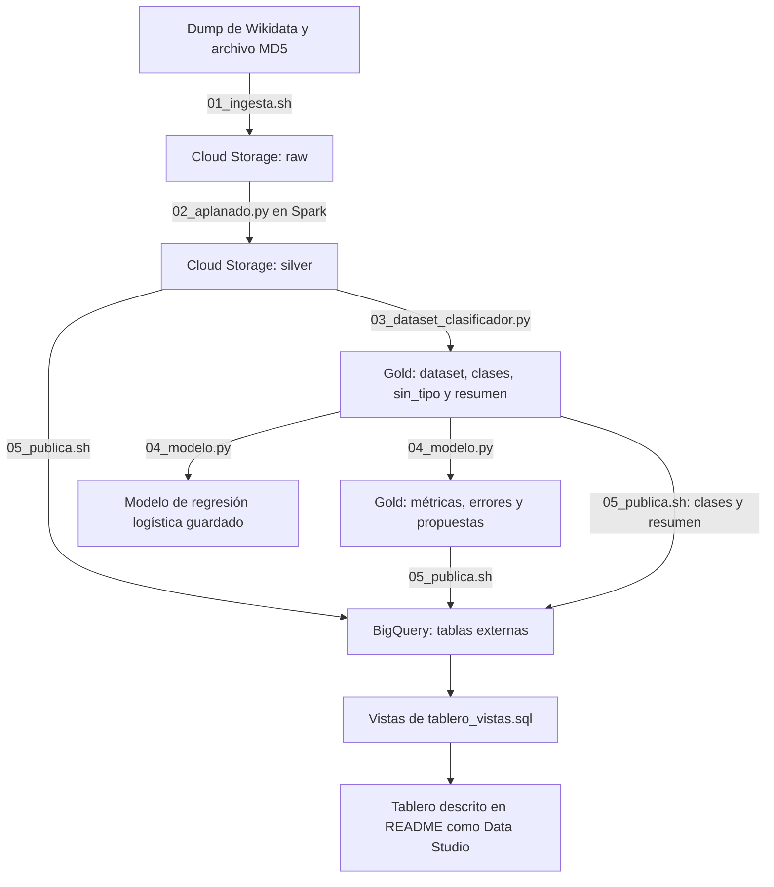
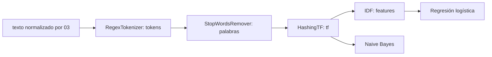
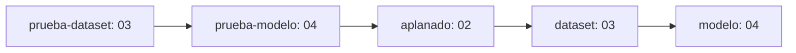

# Explicación detallada del repositorio `wikidata-gcp`

Este repositorio implementa un producto analítico sobre versiones del dump JSON de Wikidata en Google Cloud. Conserva la fuente original, la transforma en tablas consultables y utiliza descripciones en español para entrenar un modelo que propone valores de **P31, «instancia de»**, a entidades que carecen de un valor utilizable de esa propiedad.

El proyecto corresponde al trabajo final de Grandes Datos de la Maestría de la Universidad Panamericana, según el [README](README.md). Su resultado combina ingeniería de datos, controles de calidad, procesamiento distribuido, clasificación de texto y publicación para un tablero.

**Alcance de esta explicación:** revisión del contenido local del repositorio al 10 de octubre de 2026. Las descripciones de comportamiento se basan en los scripts y su configuración. Las cifras de resultados se identifican como reportadas en el README; no se volvió a ejecutar el dump completo ni se consultó el estado de los recursos de Google Cloud. Los ejemplos de entidades y conteos pequeños son ilustrativos.

## Índice

1. [Objetivo y conceptos necesarios](#objetivo)
2. [Estructura y responsabilidad de cada archivo](#archivos)
3. [Arquitectura y recorrido de los datos](#arquitectura)
4. [Organización del almacenamiento y de las versiones](#almacenamiento)
5. [Ingesta: `01_ingesta.sh`](#ingesta)
6. [Aplanado y calidad: `02_aplanado.py`](#aplanado)
7. [Construcción del dataset: `03_dataset_clasificador.py`](#dataset)
8. [Entrenamiento y propuestas: `04_modelo.py`](#modelo)
9. [Orquestación: `pipeline.yaml`](#orquestacion)
10. [Publicación: `05_publica.sh`](#publicacion)
11. [Vistas del tablero: `sql/tablero_vistas.sql`](#vistas)
12. [Requisitos y ejecución completa](#ejecucion)
13. [Consultas para entender y revisar los resultados](#consultas)
14. [Resultados reportados y su interpretación](#resultados)
15. [Limitaciones, inconsistencias y mejoras posibles](#limites)
16. [Guía de lectura y glosario](#glosario)

<a id="objetivo"></a>

## 1. Objetivo y conceptos necesarios

### 1.1. Qué problema resuelve

Wikidata contiene entidades descritas mediante identificadores, etiquetas, descripciones y declaraciones. Un dump es una copia masiva de esos datos en una fecha determinada. Consultar repetidamente su JSON completo es costoso y poco práctico para un tablero o para entrenar un clasificador.

El proyecto resuelve dos necesidades conectadas:

- **Preparar datos para análisis:** convertir el dump en tablas Parquet pequeñas en comparación con el documento original, con los campos específicos que necesita el proyecto.
- **Proponer una clasificación:** aprender la relación entre una descripción en español y una clase P31, y producir sugerencias para entidades sin esa información utilizable.

La entrada principal es un archivo `wikidata-YYYYMMDD-all.json.bz2`. Las salidas son tablas de entidades, textos y P31; un catálogo de versiones; un dataset de entrenamiento y prueba; métricas de dos modelos; un modelo guardado; y propuestas consultables desde BigQuery.

### 1.2. Entidad, etiqueta, descripción y P31

| Concepto | Significado en el proyecto | Ejemplo ilustrativo |
|---|---|---|
| Entidad | Registro identificable dentro del dump. | `Q900000001`. |
| Etiqueta | Nombre corto en un idioma. | `Persona de ejemplo`. |
| Descripción | Texto breve que ayuda a distinguir o caracterizar la entidad. | `escritora mexicana nacida en 1980`. |
| P31 | Propiedad que relaciona una entidad con una clase de la que es instancia. | Una clase que representa a los seres humanos. |
| Clase | Identificador de un valor de P31 usado como categoría del clasificador. | Un identificador `Q...`. |
| `otro` | Categoría creada por el proyecto para agrupar entidades cuya clase elegida queda fuera de las K más frecuentes. | Una clase poco frecuente que no entra en el conjunto principal. |

Hay una diferencia esencial entre dos campos que pueden parecer equivalentes:

- `tipo`, en `silver/entidades`, proviene del campo JSON `type` y distingue tipos estructurales como `item` y `property`.
- `p31`, en `silver/p31`, contiene identificadores de clases semánticas. Una entidad puede tener varios valores de P31.

El modelo intenta predecir el segundo concepto. No predice el campo estructural `tipo`.

### 1.3. Qué información utiliza el modelo

El modelo aprende únicamente del texto derivado de la **descripción en español**. La etiqueta se conserva para presentar resultados, pero no es una característica de entrenamiento. El texto en inglés se conserva en silver y se usa como alternativa para nombrar clases; no alimenta el clasificador.

Tampoco se usan imágenes, relaciones distintas de P31, enlaces a Wikipedia, referencias bibliográficas, embeddings ni modelos de lenguaje generativos. La representación implementada es una bolsa de palabras con hashing y ponderación TF-IDF para la regresión logística.

### 1.4. Qué significa una propuesta

Una propuesta es una fila de resultados con entidad, descripción, clase sugerida y probabilidad del modelo. Los scripts no envían ediciones a Wikidata. Una sugerencia con probabilidad alta sigue siendo una predicción que puede ser incorrecta.

Aunque la fuente permite múltiples P31 por entidad, el problema se transforma en **clasificación de una sola clase**: se elige una etiqueta objetivo por entidad durante la preparación y se genera una clase por propuesta.

<a id="archivos"></a>

## 2. Estructura y responsabilidad de cada archivo

El repositorio Git está dentro de la carpeta `wikidata-gcp` del espacio de trabajo. Su estructura funcional es:

```text
wikidata-gcp/
├── .gitignore
├── README.md
├── repo_summary.md
├── 01_ingesta.sh
├── 02_aplanado.py
├── 03_dataset_clasificador.py
├── 04_modelo.py
├── 05_publica.sh
├── pipeline.yaml
└── sql/
    └── tablero_vistas.sql
```

| Archivo | Responsabilidad | Tecnología | Entradas principales | Salidas principales |
|---|---|---|---|---|
| [README.md](README.md) | Presentar el proyecto, su arquitectura, resultados declarados y comandos básicos. | Markdown. | Información del proyecto. | Documentación breve. |
| [.gitignore](.gitignore) | Excluir cachés de Python del control de versiones. | Git. | Patrones `__pycache__/` y `*.pyc`. | Reglas de exclusión. |
| [01_ingesta.sh](01_ingesta.sh) | Descargar, verificar y subir una versión del dump. | Bash, `curl`, `bzip2`, Google Cloud CLI. | Fecha del dump y bucket. | Raw, muestra y log de MD5. |
| [02_aplanado.py](02_aplanado.py) | Extraer campos del JSON, revisar calidad y escribir silver. | PySpark SQL y Hadoop FS. | Dump y versión. | Cuatro tablas silver. |
| [03_dataset_clasificador.py](03_dataset_clasificador.py) | Crear clases, colapsar textos repetidos y separar train/test. | PySpark SQL. | Etiquetas y P31 de silver. | Dataset, clases, candidatos y resumen. |
| [04_modelo.py](04_modelo.py) | Entrenar dos modelos, evaluarlos y generar propuestas. | Spark ML. | Dataset, clases y candidatos gold. | Métricas, errores, propuestas y modelo. |
| [05_publica.sh](05_publica.sh) | Registrar tablas externas y ejecutar el SQL de las vistas. | Bash y BigQuery CLI. | Parquet existente en GCS. | Tablas y vistas de BigQuery. |
| [pipeline.yaml](pipeline.yaml) | Encadenar trabajos PySpark sobre un clúster administrado. | Dataproc Workflow Template. | Código y datos previamente subidos. | Ejecución ordenada de cinco trabajos. |
| [sql/tablero_vistas.sql](sql/tablero_vistas.sql) | Dar nombres y formatos adecuados a los campos del tablero. | GoogleSQL. | Tablas externas. | Cinco vistas. |
| `repo_summary.md` | Explicar en profundidad el repositorio. | Markdown. | Código y documentación local. | Este documento. |

Los números `01` a `05` indican el orden lógico de las etapas. Los tres archivos Python son programas ejecutables con `main()` y argumentos de línea de comandos; no forman un paquete Python instalable.

La carpeta oculta `.git` contiene metadatos de control de versiones y no participa en el procesamiento de datos. No hay en el contenido revisado archivos `requirements.txt`, `pyproject.toml`, Dockerfile, notebooks, pruebas unitarias, configuración de CI, infraestructura Terraform ni una exportación del tablero. Tampoco se incluyen el dump, los Parquet o el modelo entrenado: sus ubicaciones previstas son remotas.

<a id="arquitectura"></a>

## 3. Arquitectura y recorrido de los datos

### 3.1. Vista general



El diagrama representa el recorrido de datos. La plantilla `pipeline.yaml` orquesta los trabajos 02, 03 y 04 y ejecuta antes pruebas de 03 y 04. La descarga y la publicación son operaciones separadas.

### 3.2. Función de cada servicio

| Servicio o herramienta | Función concreta |
|---|---|
| VM temporal de Compute Engine | Lugar sugerido para descargar el archivo comprimido sin usar el equipo personal. |
| Cloud Storage, GCS | Almacenar fuentes, tablas, código subido, resultados y modelo. Una ruta `gs://...` identifica objetos de este almacenamiento. |
| Dataproc | Proporcionar el entorno administrado donde se ejecuta Spark. |
| Spark SQL | Leer, transformar, unir, agrupar y escribir grandes volúmenes de datos en paralelo. |
| Spark ML | Convertir texto a vectores, entrenar clasificadores y producir predicciones. |
| BigQuery | Consultar mediante SQL los Parquet registrados como tablas externas y exponer vistas. |
| Data Studio | Consumidor del resultado descrito en el README. Su configuración visual no está incluida. |

El proyecto configurado es `bigdata-507701`, el bucket es `gs://bigdata-507701-wikidata`, el dataset de BigQuery es `wikidata` y la región empleada por los comandos es `us-central1`.

### 3.3. Por qué existen raw, silver y gold

**Raw** conserva el archivo original comprimido y su archivo de sumas de comprobación. Permite volver a procesar una versión desde la misma fuente.

**Silver** contiene los campos seleccionados y organizados en tablas. El JSON anidado se convierte en entidades, textos por idioma y relaciones P31, con un catálogo que describe el procesamiento.

**Gold** contiene los productos del caso de uso: datos listos para entrenar, candidatos a clasificación, métricas y propuestas. Esta capa ya incorpora decisiones específicas del modelo, como las clases seleccionadas y la normalización del texto.

**Modelos** almacena el pipeline entrenado de Spark ML. Es un artefacto de inferencia distinto de las tablas de resultados.

### 3.4. Dependencias entre las etapas

| Etapa | Debe existir antes de ejecutarla |
|---|---|
| Ingesta | Un dump accesible, espacio local, herramientas de descarga y acceso de escritura al bucket. |
| Aplanado | Dump en la ruta de entrada; entorno Spark con acceso a esa ruta. |
| Dataset | `silver/etiquetas/version=V` y `silver/p31/version=V`. |
| Modelo | `gold/clasificador/version=V/dataset`, `clases` y `sin_tipo`. |
| Publicación | Las cuatro tablas silver y las siete salidas gold que el script registra. |
| Tablero | Tablas externas, vistas y conexión/configuración del tablero. |

Una etapa posterior no produce por sí sola las entradas faltantes. Por ejemplo, `04_modelo.py` no crea su dataset y `05_publica.sh` no entrena el modelo.

<a id="almacenamiento"></a>

## 4. Organización del almacenamiento y de las versiones

### 4.1. Árbol de rutas previsto

En este árbol, `V` representa una fecha de dump, por ejemplo `20261005`:

```text
gs://bigdata-507701-wikidata/
├── raw/wikidata/version=V/
│   ├── wikidata-V-all.json.bz2
│   └── wikidata-V-md5sums.txt
├── sample/
│   └── muestra.json
├── logs/ingesta-V/
│   └── md5.log
├── codigo/
│   ├── 02_aplanado.py
│   ├── 03_dataset_clasificador.py
│   └── 04_modelo.py
├── silver/
│   ├── entidades/version=V/
│   ├── etiquetas/version=V/
│   │   ├── idioma=es/
│   │   └── idioma=en/
│   ├── p31/version=V/
│   ├── catalogo_versiones/version=V/
│   └── _tmp_aplanado/version=V/          # Intermedio; se borra al completar 02.
├── gold/clasificador/version=V/
│   ├── clases/
│   ├── dataset/
│   ├── sin_tipo/
│   ├── resumen/
│   ├── metricas/
│   ├── metricas_por_clase/
│   ├── confusion/
│   ├── errores/
│   ├── propuestas/
│   └── _buckets/                        # Intermedio; se borra al completar 03.
│       ├── desc/
│       └── p31/
├── modelos/clasificador_p31/version=V/
└── pruebas/
    ├── silver/                         # Debe prepararse antes del workflow.
    ├── gold/clasificador/version=V/
    └── modelos/clasificador_p31/version=V/
```

Las rutas Parquet son **directorios de salida**, no nombres de un único archivo. Spark escribe dentro archivos de datos `part-...parquet` y puede añadir metadatos auxiliares. Por eso BigQuery usa patrones terminados en `*.parquet`.

### 4.2. Qué significa `version=YYYYMMDD`

La versión del dato corresponde a la fecha identificadora del dump. No equivale al commit de Git, a la fecha de entrenamiento ni a la fecha de ejecución.

Una carpeta `version=20261005` representa una instantánea concreta. Al procesar otra fecha se escriben otras carpetas, lo que permite conservar varias instantáneas. Sin embargo, los scripts usan `overwrite`: volver a procesar la misma fecha reemplaza sus salidas. El versionado por carpeta no garantiza inmutabilidad.

Los scripts Python validan la fecha con `datetime.strptime(v, "%Y%m%d")`. Los Bash requieren que se les proporcione el argumento, pero no validan por sí mismos que sea una fecha real.

### 4.3. Particiones y columnas

`version=...` e `idioma=...` siguen una organización de carpetas de tipo Hive. Cuando se lee desde un directorio adecuado, el lector puede recuperar esas claves como columnas.

En silver, `version` está codificado en la ruta y BigQuery lo descubre al registrar la tabla con particionamiento Hive automático. En etiquetas, además descubre `idioma`. No se debe asumir que esos campos están almacenados físicamente en cada archivo Parquet: al escribir con `partitionBy("idioma")`, la clave se representa en el directorio.

Las salidas gold del clasificador se registran en BigQuery apuntando a una **versión específica**. Sus esquemas escritos no incorporan una columna `version`; cambiar el destino de la tabla es lo que cambia la versión mostrada.

### 4.4. Qué permanece sin versionar

`sample/muestra.json` y los scripts subidos a `codigo/` usan nombres fijos. Una nueva subida puede reemplazarlos. El log de MD5 sí se separa en `logs/ingesta-V`, pero el archivo local de log se llama siempre `md5.log`.

Por tanto, para reproducir una ejecución también se necesita saber qué revisión del código y qué parámetros se utilizaron. El nombre de la carpeta de datos, por sí solo, no contiene esa información completa.

<a id="ingesta"></a>

## 5. Ingesta: `01_ingesta.sh`

### 5.1. Contrato de ejecución

```bash
bash 01_ingesta.sh YYYYMMDD gs://BUCKET
```

| Elemento | Significado |
|---|---|
| Primer argumento, `V` | Fecha usada para construir URL y nombres de archivo. |
| Segundo argumento, `BUCKET` | Base de almacenamiento de las salidas. |
| `URL` | `https://dumps.wikimedia.org/wikidatawiki/entities/$V`. |
| `F` | `wikidata-$V-all.json.bz2`. |
| `MD5` | `wikidata-$V-md5sums.txt`. |

El script trabaja en el directorio actual de la máquina donde se ejecuta. Allí deja el dump descargado, el archivo MD5, la muestra y `md5.log`. No elimina esos archivos locales al terminar.

### 5.2. Recorrido paso a paso

1. Activa `set -euo pipefail`, para detenerse ante errores de comandos, variables no definidas o fallas dentro de una tubería, salvo excepciones explícitas.
2. Comprueba si existe `bzip2`. Si falta, intenta instalarlo mediante `sudo apt-get`.
3. Descarga el dump con `curl -sS -L -C -`. `-L` sigue redirecciones y `-C -` intenta continuar una descarga parcial existente.
4. Descarga el archivo publicado de sumas MD5.
5. Selecciona con `grep` la línea correspondiente al dump y la pasa a `md5sum -c -`.
6. Copia el resultado de la verificación a `md5.log` con `tee`.
7. Genera una muestra pequeña desde el inicio del archivo comprimido.
8. Sube dump y sumas a `raw/wikidata/version=V/`, la muestra a `sample/` y el log a `logs/ingesta-V/`.

La función `log()` antepone una hora UTC a los mensajes. La verificación MD5 es una comprobación de integridad: si el contenido descargado no coincide con la suma seleccionada, esa tubería falla y el script no continúa hacia las subidas.

### 5.3. Cómo se obtiene la muestra

La instrucción central es:

```bash
head -c 50000000 "$F" | bzip2 -dc 2>/dev/null | head -n 5000 > muestra.json || true
```

Se toman como máximo 50 000 000 bytes **comprimidos**, se intenta descomprimir ese fragmento y se conservan como máximo 5 000 líneas de la salida. Esto evita descomprimir localmente el dump completo.

La muestra es el inicio del dump, no una muestra aleatoria ni representativa de todas sus clases. Las 5 000 líneas pueden incluir el corchete de apertura, por lo que no equivalen necesariamente a 5 000 entidades. Tampoco se añade un corchete de cierre: el resultado no tiene por qué ser un documento JSON completo, aunque el parser de 02 puede consumir las líneas de entidad.

`|| true` tolera el fallo de esta tubería, incluyendo interrupciones normales por truncamiento, pero también puede ocultar una muestra vacía o incompleta. El script no valida posteriormente su contenido.

### 5.4. Entorno sugerido por los comentarios

Los comentarios muestran una VM `ingesta-wikidata` en `us-central1-a`, con máquina `e2-small`, disco `pd-standard` de 200 GB y alcance `cloud-platform`. También muestran ejecutar el proceso con `nohup` y borrar la VM al finalizar.

Esas instrucciones son comentarios: el script no crea ni elimina la VM. El espacio necesario depende del tamaño de la versión elegida; los 200 GB son el ejemplo del repositorio, no una validación automática de capacidad.

<a id="aplanado"></a>

## 6. Aplanado y calidad: `02_aplanado.py`

### 6.1. Parámetros y configuración de Spark

| Argumento | Obligatorio | Predeterminado | Función |
|---|---|---|---|
| `--entrada` | Sí. | Sin valor. | Ruta del dump `.json.bz2` o del texto `.json`. |
| `--version` | Sí. | Sin valor. | Fecha de la versión. |
| `--salida` | Sí, salvo con `--solo-medir`. | Sin valor. | Base de silver. |
| `--max-error` | No. | `0.001`. | Fracción máxima de filas sin identificador extraído. |
| `--solo-medir` | No. | Desactivado. | Ejecutar una estimación de lectura sin publicar tablas. |

`0.001` equivale a **0.1 %**, es decir, una fila de cada mil. El programa crea una sesión llamada `aplanado-wikidata-V`, fija la zona horaria SQL en UTC y escribe timestamps Parquet como `TIMESTAMP_MICROS`.

### 6.2. Esquema mínimo de entrada

El código declara explícitamente los campos que necesita:

```text
id: string
type: string
modified: string
labels:
  es.value: string
  en.value: string
descriptions:
  es.value: string
  en.value: string
claims:
  P31: array de declaraciones
    rank: string
    mainsnak.datavalue.value.id: string
```

`VALOR`, `ES_EN`, `DECLARACION` y `ESQUEMA` son definiciones de tipos de Spark que describen esas estructuras anidadas. Los campos restantes del dump no se incorporan a las tablas.

El esquema mínimo reduce los datos materializados y mantenidos después del parseo. No evita tener que leer y descomprimir la fuente original.

### 6.3. Qué hace `leer_y_parsear()`

La fuente se lee con `spark.read.text()`: una fila de Spark por línea física. El procedimiento espera el formato del dump con una entidad por línea dentro de un arreglo JSON.

1. Excluye las líneas exactamente iguales a `[` y `]`, así como las líneas de longitud cero.
2. Quita una coma ubicada al final de la línea mediante `regexp_replace(value, ",$", "")`.
3. Interpreta el JSON mediante `from_json(..., ESQUEMA)`.
4. Extrae identificador, tipo estructural, textos es/en y valores P31.
5. Convierte `modified` a timestamp con `try_cast`; una fecha no convertible puede quedar nula.
6. Calcula `bytes_linea` con `octet_length()`.
7. Marca `ok` cuando `e.id` no es nulo.
8. Para una fila sin identificador, conserva los primeros 300 caracteres como `linea_con_error`.

El parser no está diseñado para JSON arbitrario con entidades repartidas en varias líneas. Tampoco recorta espacios antes de comparar los corchetes o después de una coma final. La forma de las líneas de entrada es parte de su contrato.

### 6.4. Extracción de P31

La expresión SQL `P31` realiza tres transformaciones sobre las declaraciones:

- Descarta las declaraciones con `rank = 'deprecated'`; acepta `rank` nulo y otros valores.
- Extrae `mainsnak.datavalue.value.id` y elimina los resultados nulos.
- Elimina valores repetidos dentro de cada entidad con `array_distinct()`.

Esto no implementa una preferencia especial por `preferred` frente a `normal`: ambos pueden conservarse. Tampoco hay una validación explícita del formato del identificador de clase o un filtro de cadenas vacías. Las declaraciones sin un identificador concreto no generan una relación utilizable en silver.

### 6.5. Intermedio y controles de calidad

El procesamiento completo escribe primero:

```text
silver/_tmp_aplanado/version=V/
```

Después lee ese Parquet para calcular controles y producir las tablas definitivas. Así, dentro de una ejecución completa, las posteriores consultas no necesitan volver a recorrer el dump comprimido. Sí se vuelve a leer el intermedio y las tablas producidas.

| Control | Cálculo o criterio | Consecuencia |
|---|---|---|
| Fuente sin filas útiles | `n_lineas == 0`. | Detiene la publicación de la nueva salida. |
| Errores de extracción | Filas con `id` nulo divididas entre filas procesadas. | Detiene el proceso si supera `--max-error`. |
| Identificadores repetidos | `n_ok - countDistinct(id)`. | Informa y aplica `dropDuplicates(["id"])`. |
| Formato de identificador | Regex `^[A-Z][1-9][0-9]*$`. | Informa; no excluye las filas ni bloquea la publicación. |
| Clases P31 sin entidad correspondiente | Identificadores de clase distintos que no aparecen en `entidades`. | Se registra después de escribir silver; no bloquea. |

La etiqueta «error de parseo» en los resultados significa, en concreto, **que no se obtuvo `id`**. No representa una validación exhaustiva de todos los campos, de la semántica de Wikidata o de toda la estructura JSON. Una fila con identificador puede aceptarse aunque tenga una fecha nula o datos ausentes.

Si falla el control de filas o de proporción de errores, se lanza `RuntimeError`, se muestran hasta tres ejemplos y se conserva el intermedio para diagnóstico. El proceso no escribe entonces las nuevas tablas definitivas; si ya existían salidas de una ejecución anterior de la misma fecha, no se eliminan por ese rechazo.

La desduplicación de identificadores no establece un orden para elegir la fila conservada. Ante duplicados con contenidos diferentes, no se garantiza que gane la modificación más reciente.

### 6.6. Tablas silver producidas

| Tabla | Unidad de una fila | Columnas de datos | Detalles |
|---|---|---|---|
| `entidades` | Una entidad tras desduplicar por ID. | `id: string`, `tipo: string`, `modificado: timestamp`. | Incluye entidades aceptadas por el parser. |
| `etiquetas` | Una entidad y un idioma. | `id: string`, `etiqueta: string`, `descripcion: string`; `idioma` en partición. | Solo es/en. Se omite la fila si etiqueta y descripción son ambas nulas. |
| `p31` | Una relación entidad–clase. | `id: string`, `p31: string`. | `explode()` convierte el arreglo en filas. Una entidad puede aparecer varias veces. |
| `catalogo_versiones` | Una versión procesada. | Campos descritos abajo. | Una fila y una partición de salida. |

Todas las rutas se separan por `version=V`. Las escrituras usan `overwrite` para esa versión.

Una entidad sin P31 utilizable no tiene fila en `p31`. En cambio, puede existir en `entidades` y en `etiquetas`. La ausencia en `p31` es precisamente la condición usada después para formar candidatos.

### 6.7. Diccionario completo de `catalogo_versiones`

| Campo | Tipo Spark | Qué mide o conserva |
|---|---|---|
| `fecha_dump` | `date` | Fecha interpretada desde `V`. |
| `archivo` | `string` | Ruta exacta recibida como entrada. |
| `bytes_archivo` | `long` | Tamaño de la fuente obtenido mediante Hadoop FS; puede ser nulo si no se obtiene. |
| `md5_publicado` | `string` | Suma encontrada en el archivo MD5 adyacente; puede ser nula. |
| `n_lineas` | `long` | Líneas candidatas a entidad después de excluir envoltura y líneas vacías. |
| `n_error_parseo` | `long` | Líneas donde no se extrajo un ID. |
| `pct_error_parseo` | `double` | Fracción de esas líneas sobre `n_lineas`, entre 0 y 1 en el caso normal. |
| `bytes_json` | `long` | Suma de bytes de las líneas procesadas más un byte por salto de línea. |
| `n_entidades` | `long` | Filas de entidades efectivamente publicadas. |
| `n_items` | `long` | Entidades con `tipo = 'item'`. |
| `n_propiedades` | `long` | Entidades con `tipo = 'property'`. |
| `n_ids_duplicados` | `long` | Exceso de filas con ID sobre IDs distintos antes de desduplicar. |
| `n_ids_invalidos` | `long` | Filas aceptadas cuyo ID no cumple la regex. |
| `n_etiquetas_es` | `long` | Etiquetas no nulas en español. |
| `n_descripciones_es` | `long` | Descripciones no nulas en español. |
| `n_etiquetas_en` | `long` | Etiquetas no nulas en inglés. |
| `n_descripciones_en` | `long` | Descripciones no nulas en inglés. |
| `n_filas_etiquetas` | `long` | Filas entidad–idioma publicadas, sumando es/en. |
| `n_filas_p31` | `long` | Total de relaciones P31 publicadas. |
| `n_clases_p31` | `long` | Identificadores de clase P31 distintos. |
| `n_clases_p31_huerfanas` | `long` | Clases P31 distintas sin entidad correspondiente en la versión. |
| `segundos_lectura` | `double` | Tiempo desde el inicio del procesamiento completo hasta terminar el Parquet intermedio. |
| `segundos_total` | `double` | Tiempo hasta calcular el catálogo, incluyendo tablas y sus conteos; excluye la escritura final del catálogo y la limpieza posterior. |
| `spark_version` | `string` | Versión real de Spark utilizada. |
| `procesado_en` | `timestamp` | Momento UTC de creación del registro. |

`version` se obtiene de la partición de ruta; no es uno de los campos físicos construidos en `fila`.

`bytes_json` es una estimación basada en las líneas consideradas, no una medición exacta del archivo completo descomprimido: no incluye las líneas de envoltura excluidas y asume un byte por salto de línea. El MD5 guardado es el publicado, leído del archivo auxiliar; 02 no recalcula ni verifica la suma del dump. La verificación efectiva ocurre en 01.

### 6.8. Utilidades de archivos

| Función | Responsabilidad |
|---|---|
| `_fs(spark, ruta)` | Obtener un objeto de filesystem y un `Path` mediante la JVM y la configuración de Hadoop. |
| `existe()` | Comprobar existencia. |
| `borrar()` | Borrar una ruta existente, incluyendo su contenido. |
| `borrar_si_vacia()` | Borrar un directorio solo cuando no contiene elementos. |
| `tamano()` | Obtener la longitud mediante `getContentSummary`; devolver `None` si falla. |
| `md5_publicado()` | Leer el archivo de sumas junto a la entrada y buscar el nombre del dump. |

La abstracción de Hadoop permite que estas funciones usen rutas locales o `gs://` cuando el entorno tiene el conector correspondiente. Al completar correctamente el proceso se borra su intermedio y, si queda vacío, el directorio `_tmp_aplanado`.

### 6.9. Modo `--solo-medir`

`medir()` convierte el resultado del parser a RDD, consulta su número de particiones y elige la primera y la ubicada en la mitad. Si ambas coinciden, mide una sola.

`_contar()` recorre las filas de cada partición elegida y devuelve número de filas, errores, bytes y segundos. Se extrapola el promedio al número total de particiones para mostrar tamaño aproximado de JSON y **horas-núcleo de lectura**.

Una hora-núcleo representa una hora de trabajo de un núcleo. No equivale directamente a una hora de duración del flujo completo. La estimación no incluye todas las escrituras, uniones, controles, entrenamiento o publicación, ni garantiza que las particiones muestreadas representen el resto del dump.

<a id="dataset"></a>

## 7. Construcción del dataset: `03_dataset_clasificador.py`

### 7.1. Propósito y parámetros

Este script transforma tablas de textos y relaciones en un problema supervisado: aprender una clase a partir de una descripción. Su unidad final es **una descripción normalizada única**, aunque los datos de origen tengan millones de entidades que compartan textos similares.

| Argumento | Obligatorio | Predeterminado | Función |
|---|---|---|---|
| `--silver` | Sí. | Sin valor. | Base de las tablas de entrada. |
| `--gold` | Sí. | Sin valor. | Base sobre la que se añade `clasificador/version=V`. |
| `--version` | Sí. | Sin valor. | Versión de entrada y salida. |
| `--clases` | No. | `20`. | Cantidad K de valores P31 principales. |
| `--max-por-clase` | No. | `30000`. | Tamaño esperado máximo del muestreo por clase. |
| `--prueba` | No. | `0.2`. | Fracción deseada para prueba. |
| `--buckets` | No. | `64`. | Número de buckets usados en las tablas intermedias por ID. |
| `--semilla` | No. | `42`. | Semilla de muestreo y orden aleatorio. |

### 7.2. Selección de la población de entrada

Se leen las etiquetas de la versión indicada y se conservan filas con `idioma = 'es'` y `descripcion` no nula. Se seleccionan `id`, `etiqueta` y `descripcion`. También se lee `p31`, con `id` y `p31`.

En este primer filtro, una descripción vacía o compuesta solo por espacios todavía cuenta como no nula. El filtro de texto no vacío se aplica más adelante al conjunto con etiqueta de entrenamiento.

El programa no lee `silver/entidades` para filtrar por tipo estructural. Esto significa que una propiedad con descripción española y sin una relación P31 utilizable también puede entrar en `sin_tipo`. No existe una restricción explícita a `tipo = 'item'`.

### 7.3. Bucketing y tablas temporales

Antes de unir por ID, escribe dos tablas del catálogo de Spark:

| Nombre | Ruta |
|---|---|
| `wd_desc_es_V` | `gold/clasificador/version=V/_buckets/desc`. |
| `wd_p31_V` | `gold/clasificador/version=V/_buckets/p31`. |

Ambas se escriben con `bucketBy(--buckets, "id")` y `sortBy("id")`. La intención es distribuir los mismos identificadores de forma compatible y permitir que Spark aproveche esa distribución en la unión.

Un **shuffle** es una redistribución de datos entre tareas o máquinas, por ejemplo para reunir filas de la misma clave. El bucketing busca reducir esa redistribución durante los joins por ID, pero prepararlo también implica trabajo de escritura y distribución.

El código inspecciona el plan de la primera unión buscando la cadena `Exchange hashpartitioning` y escribe un mensaje según aparezca o no. Este diagnóstico no demuestra que el proceso completo carezca de shuffle: agrupaciones, ventanas y el `repartition(16)` posterior también pueden redistribuir datos.

Al finalizar se borran las tablas del catálogo con `DROP TABLE` y el directorio `_buckets`. Una falla anterior puede dejar esos intermedios, porque la limpieza no está protegida por `finally`.

### 7.4. Cómo se seleccionan las clases

La unión interna entre descripciones españolas y P31 produce `con_tipo`. Para cada valor P31 se cuentan sus apariciones en ese conjunto, se ordenan por frecuencia descendente y se conservan las K primeras. Los empates se resuelven por identificador P31.

La frecuencia se calcula sobre relaciones con entidades que tienen descripción española. No se calcula sobre todas las entidades del dump ni sobre descripciones únicas.

A cada clase se asigna un `rango`: 1 para la más frecuente, 2 para la siguiente, etc. Su nombre visible se obtiene de una etiqueta española, o de una inglesa si no hay española. Cuando el ID no está en el diccionario de nombres se utiliza el propio ID.

Un ejemplo de selección, con K = 2:

| Clase | Apariciones | Rango | ¿Entra como clase explícita? |
|---|---|---|---|
| `Q_A` | 1 000 | 1 | Sí. |
| `Q_B` | 500 | 2 | Sí. |
| `Q_C` | 100 | Fuera del top K. | Se agrupa en `otro` al asignar etiquetas. |

Los identificadores de este ejemplo son simbólicos; muestran la lógica de selección.

### 7.5. Cómo una entidad con varios P31 recibe una clase

Cada entidad del conjunto etiquetado termina con una sola clase:

- Si tiene un P31 del top K, se usa ese identificador.
- Si tiene varios P31 del top K, se elige el de menor rango: la clase globalmente más frecuente entre las seleccionadas.
- Si tiene P31, pero ninguno está en el top K, se asigna `otro`.

La elección se implementa mediante el mínimo de `rango` por entidad. No se elige la clase más específica de una jerarquía ni se usa una prioridad semántica de Wikidata.

**`otro` y `sin_tipo` son conceptos distintos:** `otro` es una etiqueta de entrenamiento para entidades con relaciones P31 fuera del conjunto principal; `sin_tipo` es el conjunto de candidatos sin una fila P31 utilizable.

### 7.6. Normalización del texto

La función `normalizar()` aplica:

1. Conversión a minúsculas.
2. Sustitución de cada secuencia de dígitos ASCII `[0-9]+` por `0`.
3. Sustitución de cada secuencia de espacios en blanco por un espacio.
4. Eliminación de espacios al principio y al final.

```text
"  Publicado   en 2019  "  →  "publicado en 0"
"publicado en 2020"        →  "publicado en 0"
"Escritora mexicana"       →  "escritora mexicana"
```

No elimina acentos, no lematiza y no quita puntuación en este paso. La puntuación se trata después al tokenizar en el modelo. El reemplazo de años y otros números permite colapsar descripciones que solo cambian en valores numéricos, a costa de perder esa información.

Para los ejemplos etiquetados se eliminan textos de longitud cero después de normalizar.

### 7.7. Desduplicación y clase mayoritaria

Primero se agrupa por `texto` y `clase` para contar cuántas entidades comparten esa combinación. Después, por cada texto, se conserva la clase con mayor número de entidades. Los empates se resuelven por el orden del identificador de clase.

Se guardan dos indicadores:

```text
n_entidades = número total de entidades que comparten el texto normalizado
pureza = entidades de la clase ganadora / n_entidades
```

Por ejemplo, si diez entidades comparten `texto`, ocho pertenecen a la clase A y dos a la B, el resultado es una fila con clase A, `n_entidades = 10` y `pureza = 0.8`.

Las dos entidades de B contribuyen a la ambigüedad registrada, pero no aparecen como ejemplos separados de B. Se conserva además una descripción original representativa mediante `first()`, sin establecer cuál debe ser seleccionada.

No hay un umbral mínimo de pureza. Una descripción ambigua puede entrar al entrenamiento. `n_entidades` y `pureza` son columnas informativas: 04 no las emplea como pesos de entrenamiento o de evaluación.

### 7.8. Muestreo por clase y separación train/test

Para una clase con `n` textos únicos, la probabilidad de conservar cada texto es:

```text
fracción de muestreo = min(1, max_por_clase / n)
```

`sampleBy()` realiza el muestreo con la semilla configurada. Si existen 100 000 textos y el parámetro vale 30 000, usa una fracción de 0.3. El resultado esperado es aproximadamente 30 000, pero el número real puede ser mayor o menor. **No es un tope estricto.**

Después del muestreo, para cada clase:

1. Se cuenta cuántos textos quedaron.
2. Se ordenan aleatoriamente con `rand(semilla)`.
3. Se asignan a test los primeros `floor(n * prueba)`.
4. Se asigna el resto a train.

| Textos muestreados de una clase | Test con `prueba=0.2` | Train | Fracción real de test |
|---|---|---|---|
| 4 | 0 | 4 | 0 %. |
| 7 | 1 | 6 | Aproximadamente 14.3 %. |
| 100 | 20 | 80 | 20 %. |

Desduplicar antes de separar impide que el mismo texto normalizado aparezca en ambos conjuntos. Esta decisión evita una forma de fuga de información: evaluar sobre una descripción idéntica a otra ya usada para entrenar. Aun así, textos distintos pueden ser casi equivalentes o compartir plantillas.

Se escribe `dataset` después de `repartition(16)`. La semilla ayuda a repetir la selección, pero no basta para garantizar resultados idénticos entre entornos, particionamientos o cambios de código.

### 7.9. Entidades sin P31 utilizable

Se ejecuta un `left_anti` entre descripciones y relaciones P31. Esta unión conserva las filas del lado de descripciones cuyos IDs no tienen coincidencia en el lado P31.

En consecuencia, `sin_tipo` incluye entidades que no tuvieron una relación después de la depuración de 02. Puede incluir casos con declaraciones exclusivamente `deprecated` o sin un ID de clase extraíble; no necesariamente significa ausencia absoluta de la propiedad en el JSON original.

A estas filas también se les añade `texto` normalizado. No se desduplican por texto y no se aplica el filtro de longitud positiva del conjunto etiquetado. Así, dos entidades con la misma descripción pueden recibir dos propuestas independientes, y un texto vacío puede llegar a la inferencia.

### 7.10. Diccionario de las cuatro salidas

| Salida | Campos y tipos | Unidad |
|---|---|---|
| `dataset` | `texto string`, `descripcion string`, `clase string`, `n_entidades long`, `pureza double`, `split string`. | Una descripción normalizada única seleccionada. |
| `sin_tipo` | `id string`, `etiqueta string`, `descripcion string`, `texto string`. | Una entidad candidata. |
| `clases` | `clase string`, `nombre_clase string`, `rango int`, `entidades long`, `descripciones_unicas long`, `en_dataset long`. | Una categoría, incluyendo `otro`. |
| `resumen` | Los nueve campos siguientes, todos `long`. | Una ejecución de preparación de la versión. |

| Campo de `resumen` | Significado |
|---|---|
| `entidades_con_descripcion_es` | Filas españolas con descripción no nula antes del filtro de texto vacío. |
| `con_p31` | Entidades del conjunto etiquetado, después del filtro de texto normalizado no vacío. |
| `sin_p31` | Filas publicadas en `sin_tipo`. |
| `descripciones_unicas` | Total de textos únicos después de elegir su clase mayoritaria, antes del muestreo. |
| `en_dataset` | Filas que quedaron después del muestreo. |
| `entrenamiento` | Filas `train`. |
| `prueba` | Filas `test`. |
| `clases` | Número de clases principales encontradas más una por `otro`. |
| `segundos` | Tiempo hasta construir el resumen; no incluye toda la limpieza posterior. |

En `clases`, `entidades` es el conteo después de asignar una sola clase por entidad y excluir textos vacíos. No siempre coincide con la frecuencia de relaciones usada para elegir el top K. `descripciones_unicas` ya refleja la selección de clase mayoritaria por texto; `en_dataset` refleja además el muestreo.

Si existen descripciones vacías con P31, no tiene por qué cumplirse `entidades_con_descripcion_es = con_p31 + sin_p31`, porque los conteos corresponden a filtros ligeramente distintos. En cambio, `en_dataset = entrenamiento + prueba` sí describe la partición de las filas publicadas.

<a id="modelo"></a>

## 8. Entrenamiento y propuestas: `04_modelo.py`

### 8.1. Parámetros y entradas

| Argumento | Obligatorio | Predeterminado | Función |
|---|---|---|---|
| `--gold` | Sí. | Sin valor. | Base de las salidas del paso 03. |
| `--modelos` | Sí. | Sin valor. | Base donde se guarda el pipeline final. |
| `--version` | Sí. | Sin valor. | Fecha de la versión. |
| `--umbral` | No. | `0.8`. | Probabilidad mínima para conservar una propuesta. |
| `--reg` | No. | `0.001`. | Regularización de regresión logística. |
| `--iter` | No. | `100`. | Máximo de iteraciones de regresión logística. |

Lee `dataset`, `clases` y posteriormente `sin_tipo` bajo `gold/clasificador/version=V`. Usa las filas con `split = 'train'` para ajustar y `split = 'test'` para evaluar; no hace una nueva separación.

### 8.2. Conversión de clases a índices

`StringIndexer` aprende las categorías a partir de train y transforma cada valor de `clase` en una etiqueta numérica `label`. Los clasificadores usan ese número como objetivo de entrenamiento.

Los índices aprendidos no deben confundirse con el `rango` del catálogo de clases: son una representación interna del modelo. `IndexToString` utiliza las etiquetas aprendidas para convertir `prediction` de nuevo al identificador original en `clase_predicha`.

`handleInvalid='skip'` indica que las filas con etiquetas desconocidas al transformar pueden omitirse. Por eso `n_train` y `n_test` se cuentan después de aplicar indexador y transformación de texto. No son una comprobación de que todas las filas originales hayan llegado a la evaluación.

### 8.3. Del texto a un vector numérico



| Etapa | Comportamiento exacto | Motivo |
|---|---|---|
| `RegexTokenizer` | Separa por secuencias que no sean letras o números Unicode; exige al menos dos caracteres por token. | Convertir la frase en unidades de palabra. |
| `StopWordsRemover` | Utiliza la lista predeterminada de palabras vacías en español de Spark. | Excluir palabras frecuentes de escasa capacidad discriminativa. |
| `HashingTF` | Produce frecuencias en un vector de `1 << 18 = 262144` posiciones. | Representar las palabras sin construir un vocabulario explícito. |
| `IDF` | Ajusta pesos con entrenamiento y usa `minDocFreq=2`. | Reducir la influencia de términos muy comunes y anular el peso de posiciones presentes en menos de dos documentos de entrenamiento. |

**TF** corresponde a frecuencia de términos. **IDF** aumenta el peso relativo de posiciones menos comunes entre los documentos de entrenamiento. Su combinación genera las características TF-IDF.

HashingTF permite trabajar con un tamaño de vector fijo, pero diferentes términos pueden caer en la misma posición: son colisiones de hash. Los pesos IDF se calculan sobre esas posiciones, no sobre un diccionario legible de palabras.

La normalización de 03 transforma números en `0`. Como el tokenizador exige longitud mínima de dos caracteres, ese token aislado se descarta. La identidad numérica original ya se había perdido antes.

El indexador y el componente IDF se ajustan exclusivamente con entrenamiento. Test se transforma con los componentes ya aprendidos. Los DataFrames transformados de train y test se almacenan en caché para reutilizarlos entre los dos modelos.

### 8.4. Los dos modelos comparados

| Nombre guardado en métricas | Modelo | Vector utilizado | Configuración explícita |
|---|---|---|---|
| `regresion_logistica` | Regresión logística multinomial. | `features`, TF-IDF. | `family='multinomial'`, `maxIter=--iter`, `regParam=--reg`. |
| `naive_bayes` | Naive Bayes multinomial. | `tf`, conteos después del hashing. | `modelType='multinomial'`, `smoothing=1.0`. |

La regresión logística aprende pesos que relacionan características con las clases. La regularización limita la magnitud de esos pesos y ayuda a controlar el sobreajuste.

Naive Bayes es una línea base de clasificación basada en frecuencias y una suposición simplificadora de independencia de características condicionada a la clase. Aquí usa suavizado 1.0.

Ambos comparten palabras y hashing, pero **no usan el mismo vector final**: Naive Bayes recibe TF y regresión logística recibe TF-IDF. Describir ambos como entrenados con TF-IDF sería impreciso.

El programa compara sus métricas, pero el modelo de producción está fijado en el código: siempre se guarda y usa regresión logística. No hay una selección automática del ganador.

### 8.5. Confianza de la predicción

Cada clasificador produce `prediction` y un vector `probability`. El programa define `probabilidad` como el valor máximo de ese vector:

```text
probabilidad = max(probability)
```

Ese valor expresa la confianza asignada por el modelo entre las clases que conoce. No hay calibración de probabilidades ni una evaluación que demuestre que `0.8` significa exactamente 80 % de aciertos en las propuestas.

### 8.6. Evaluación y fórmulas

`evaluar()` agrupa las predicciones de test por clase real y clase predicha. Lleva al controlador esos conteos de confusión, no todas las filas originales, y calcula por clase:

```text
TP = filas de la clase c correctamente predichas como c
soporte = filas cuya clase real es c
predichos = filas asignadas por el modelo a c

precision = TP / predichos
recall = TP / soporte
F1 = 2 * precision * recall / (precision + recall)

accuracy = total de predicciones correctas / total de filas evaluadas
F1 macro = promedio de F1 de las clases con soporte real mayor que cero
```

Cuando el denominador correspondiente es cero, se utiliza cero para la métrica. Para F1 macro se excluyen las clases sin soporte real en test. Una clase sin aparición real ni predicha puede no generar siquiera una fila de métricas por clase.

| Métrica | Pregunta que ayuda a responder |
|---|---|
| Accuracy | ¿Qué proporción de los ejemplos evaluados recibió la clase de referencia? |
| Precision de una clase | De los ejemplos que el modelo llamó esa clase, ¿cuántos lo eran según la etiqueta de referencia? |
| Recall de una clase | De los ejemplos que realmente pertenecían a esa clase, ¿cuántos encontró? |
| F1 de una clase | ¿Qué equilibrio logra entre precision y recall? |
| F1 macro | ¿Cómo rinde, en promedio, dando el mismo peso a cada clase con soporte de prueba? |
| Soporte | ¿Cuántos ejemplos reales de esa clase hubo en test? |

La unidad evaluada es la descripción normalizada única seleccionada. Una fila con `n_entidades=100000` cuenta lo mismo que una con `n_entidades=1`. No se ponderan entrenamiento ni métricas por `n_entidades` o `pureza`.

Por tanto, accuracy no equivale a la proporción de entidades de todo Wikidata correctamente clasificadas ni a la precisión de las propuestas filtradas por umbral. Son poblaciones y procedimientos diferentes.

### 8.7. Salidas de métricas y revisión

Todas estas rutas cuelgan de `gold/clasificador/version=V/`:

| Salida | Esquema | Contenido |
|---|---|---|
| `metricas` | `modelo string`, `accuracy double`, `f1_macro double`, `n_train long`, `n_test long`, `n_clases int`, `segundos double`. | Una fila por modelo. |
| `metricas_por_clase` | `modelo string`, `clase string`, `nombre_clase string`, `precision double`, `recall double`, `f1 double`, `soporte long`. | Rendimiento por modelo y categoría evaluada. |
| `confusion` | `modelo string`, `clase_real string`, `clase_predicha string`, `n long`. | Conteo de cada combinación real/predicha observada. |
| `errores` | `descripcion string`, `clase_real string`, `clase_predicha string`, `probabilidad double`, `n_entidades long`. | Hasta 20 errores de mayor confianza por clase real, solo de regresión logística. |
| `propuestas` | `id string`, `etiqueta string`, `descripcion string`, `clase_propuesta string`, `nombre_clase string`, `probabilidad double`. | Recomendaciones por entidad. |

Las cuatro primeras salidas se escriben con `coalesce(1)`; propuestas se escribe distribuida. El orden físico de columnas de propuestas puede variar respecto de esta presentación por la unión con el catálogo.

`segundos` mide la llamada `fit()` del clasificador correspondiente. Excluye el ajuste inicial del preprocesamiento, la evaluación, la escritura y la inferencia sobre candidatos.

La tabla `errores` sirve para revisión manual de equivocaciones en las que el modelo mostró mayor confianza. No incluye todos los errores ni errores de Naive Bayes. Un desacuerdo con la etiqueta del dataset también puede reflejar una simplificación de P31 o una descripción ambigua.

### 8.8. Pipeline final guardado

Se persiste en:

```text
modelos/clasificador_p31/version=V/
```

Sus etapas son:

```text
RegexTokenizer
→ StopWordsRemover
→ HashingTF
→ IDF ajustado
→ regresión logística ajustada
→ IndexToString
```

No incluye StringIndexer, porque una entrada de inferencia no necesita conocer su clase real. Sí incluye la traducción de la salida numérica a clase textual.

Tampoco incluye `normalizar()` de 03. Para obtener un comportamiento coherente con el entrenamiento, quien cargue el modelo debe proporcionar **una columna `texto` ya normalizada**, no únicamente una columna `descripcion` cruda.

No se guarda el modelo de Naive Bayes. No se vuelve a ajustar la regresión logística con train y test juntos: se guarda el modelo que ya fue ajustado solo con train.

### 8.9. Generación de propuestas

El pipeline final transforma todas las filas de `sin_tipo`. Se conservan aquellas que satisfacen ambas condiciones:

```text
probabilidad >= umbral
clase_predicha != 'otro'
```

Después se renombran los campos y se une el nombre legible de la clase. Se escribe `propuestas` y se cuentan las propuestas y las filas candidatas para mostrarlas en el log.

No se añade ese conteo a `resumen`, que fue creado por 03 antes de entrenar. La salida no se incorpora a silver y no cambia Wikidata. Solo las clases explícitas conocidas por el modelo pueden proponerse; no puede descubrir una nueva clase fuera del vocabulario entrenado.

<a id="orquestacion"></a>

## 9. Orquestación: `pipeline.yaml`

### 9.1. Cadena de trabajos



`prerequisiteStepIds` establece dependencias secuenciales. Si un paso falla, los pasos que dependen de él no avanzan normalmente en esta cadena.

| `stepId` | Script | Datos y configuración |
|---|---|---|
| `prueba-dataset` | 03. | `pruebas/silver` → `pruebas/gold`, `--clases=10`. |
| `prueba-modelo` | 04. | `pruebas/gold` → resultados y `pruebas/modelos`. |
| `aplanado` | 02. | Dump completo raw → `silver`. |
| `dataset` | 03. | `silver` → `gold`, K predeterminado de 20. |
| `modelo` | 04. | `gold` → métricas, propuestas y `modelos`. |

Los cinco trabajos leen el código desde `gs://bigdata-507701-wikidata/codigo/`. Editar un script local no actualiza automáticamente la copia que ejecuta el workflow; hay que volver a subirlo.

### 9.2. Qué comprueban las pruebas iniciales

Las pruebas ejecutan los mismos programas 03 y 04 sobre rutas separadas y con menos clases. Buscan detectar fallas de ejecución antes del aplanado completo.

No son pruebas unitarias ni una suite con resultados esperados. No comparan accuracy o F1 con un mínimo exigido. Si los scripts terminan sin excepción, el flujo puede continuar aunque sus métricas sean bajas.

Existe un requisito previo que no se automatiza en el YAML: **deben existir los Parquet de `pruebas/silver`**. La ingesta solo sube `sample/muestra.json`; la plantilla no ejecuta 02 sobre esa muestra antes de `prueba-dataset`. La sección de ejecución de este documento muestra cómo preparar esa entrada.

El clúster completo se crea antes de estos trabajos de prueba. La cadena evita llegar al procesamiento completo si fallan, pero no evita el aprovisionamiento inicial del clúster.

### 9.3. Configuración del clúster

| Elemento | Valor en YAML |
|---|---|
| Tipo de placement | `managedCluster`. |
| Nombre de clúster | `wd-pipeline`. |
| Maestros | 1. |
| Trabajadores | 5. |
| Tipo de máquina de ambos | `e2-standard-4`. |
| Disco de arranque de ambos | `pd-balanced`, 50 GB por instancia. |

Según el diseño descrito en el repositorio, Dataproc administra la creación y eliminación del clúster alrededor del flujo. El YAML no incluye el aprovisionamiento del bucket, la VM de ingesta, el dataset inicial, las cuentas de servicio o el tablero.

El README menciona Spark 3.5, pero el archivo **no fija una versión de imagen de Dataproc mediante `softwareConfig.imageVersion`**. La versión efectiva no queda determinada únicamente por esta configuración. El catálogo de 02 sí registra la versión de Spark que utilizó al ejecutarse.

### 9.4. Versión fija y ejecución asíncrona

El YAML revisado utiliza `20261005` en los cinco trabajos y en el nombre y carpeta del dump completo. No tiene un parámetro central de versión. Para cambiarla hay que mantener coherentes todas las apariciones relevantes, incluyendo la versión de pruebas y la ruta raw.

El comando documentado incluye `--async`:

```bash
gcloud dataproc workflow-templates instantiate-from-file \
  --file=pipeline.yaml --region=us-central1 --async
```

Esto devuelve el control antes de que termine el procesamiento. La publicación en BigQuery debe esperar a que los trabajos hayan concluido correctamente y sus salidas estén completas.

<a id="publicacion"></a>

## 10. Publicación: `05_publica.sh`

### 10.1. Contrato y configuración

```bash
bash 05_publica.sh YYYYMMDD
```

El argumento selecciona la versión gold que se publicará. Las demás ubicaciones están escritas directamente en el script:

| Variable o ajuste | Valor |
|---|---|
| `P` | `bigdata-507701`. |
| `DS` | `wikidata`. |
| `B` | `gs://bigdata-507701-wikidata`. |
| Región al consultar/crear dataset | `us-central1`. |

Como 01, utiliza `set -euo pipefail`. No valida la fecha antes de construir las rutas.

### 10.2. Preparación del dataset

Intenta consultar el dataset con `bq show`. Si ese comando falla, intenta crearlo con `bq mk -d` en `us-central1`.

Ese mecanismo no distingue entre inexistencia del dataset y otros motivos de falla, como falta de permisos. Tampoco valida explícitamente la ubicación de uno que ya existe. El diseño requiere que el acceso a los archivos y la configuración regional sean compatibles.

### 10.3. Cuatro tablas externas silver

Se registran `entidades`, `etiquetas`, `p31` y `catalogo_versiones`.

Para cada tabla, el script genera una definición con:

- Formato `PARQUET`.
- `--hive_partitioning_mode=AUTO`.
- Prefijo de origen `gs://.../silver/T`.
- Patrón de objetos `gs://.../silver/T/*.parquet`.

Guarda la definición en `/tmp/def_T.json`, intenta borrar la tabla anterior y crea la nueva tabla externa. Los patrones y prefijos están diseñados para abarcar las carpetas de versiones de cada tabla, y las claves Hive se deducen de sus rutas.

Una tabla externa registra cómo consultar los archivos que ya están en GCS. Este script no carga ni copia el contenido de los Parquet a una tabla nativa de BigQuery.

### 10.4. Siete tablas externas gold

| Tabla de BigQuery | Directorio relativo bajo `gold/clasificador/version=V/` |
|---|---|
| `clasificador_clases` | `clases/`. |
| `clasificador_metricas` | `metricas/`. |
| `clasificador_metricas_por_clase` | `metricas_por_clase/`. |
| `clasificador_propuestas` | `propuestas/`. |
| `clasificador_resumen` | `resumen/`. |
| `clasificador_confusion` | `confusion/`. |
| `clasificador_errores` | `errores/`. |

Se usan nombres estables para tablas que apuntan a una fecha concreta. Publicar otra versión reemplaza sus definiciones para redirigirlas a esa fecha. A diferencia de silver, estas tablas no se crean con el descubrimiento Hive de todas las versiones.

El script no registra `dataset`, `sin_tipo` o el modelo guardado como tablas de BigQuery. Los primeros dos siguen en GCS para el procesamiento; el modelo sigue como artefacto Spark ML.

### 10.5. Ejecución del SQL y resultado final

Se ejecuta `sql/tablero_vistas.sql` mediante `bq query --use_legacy_sql=false`. El script resuelve la ruta del SQL respecto de su propia ubicación con `dirname "$0"`, por lo que el SQL no depende de encontrarse en el directorio actual.

Al final, `bq ls` muestra los objetos del dataset. Con una ejecución exitosa y sin considerar objetos preexistentes ajenos al proyecto, el código crea **11 tablas externas y 5 vistas**.

La recreación es secuencial. Mientras se reemplazan tablas pueden existir intervalos en los que alguna no está disponible. Una falla intermedia puede dejar tablas ausentes o tablas gold que apunten a versiones diferentes. No hay una transacción global de publicación.

<a id="vistas"></a>

## 11. Vistas del tablero: `sql/tablero_vistas.sql`

El SQL usa `CREATE OR REPLACE VIEW` y referencias completas a `bigdata-507701.wikidata`. Las vistas sirven para seleccionar campos, convertir unidades y dar nombres adecuados a la presentación. No materializan nuevas copias de los datos.

Los nombres de columnas de salida evitan espacios y acentos. Algunas etiquetas almacenadas como datos sí tienen acentos. Los comentarios explican que los nombres largos de presentación se configuran en la fuente de datos del tablero.

### 11.1. `tablero_version`

Parte de `catalogo_versiones`. Presenta una fila por versión registrada.

| Columna de la vista | Origen o transformación |
|---|---|
| `Version` | `PARSE_DATE('%Y%m%d', CAST(version AS STRING))`. |
| `Entidades` | `n_entidades`. |
| `gb_bz2` | `bytes_archivo / 1e9`, redondeado a un decimal. |
| `tb_json` | `bytes_json / 1e12`, redondeado a dos decimales. |
| `errores_parseo` | `n_error_parseo`. |
| `ids_repetidos` | `n_ids_duplicados`. |
| `clases_p31` | `n_clases_p31`. |
| `clases_sin_entidad` | `n_clases_p31_huerfanas`. |
| `horas_proceso` | `segundos_total / 3600`, redondeado a dos decimales. |
| `md5` | `md5_publicado`. |

GB y TB son unidades decimales, no GiB y TiB. `horas_proceso` mide el procesamiento registrado por **02**, con los límites temporales explicados antes; no suma ingesta, dataset, entrenamiento y publicación.

### 11.2. `tablero_cobertura`

Convierte cuatro conteos de cada fila del catálogo en cuatro filas de presentación mediante `UNNEST` de un arreglo de estructuras:

- Descripción en inglés.
- Etiqueta en inglés.
- Descripción en español.
- Etiqueta en español.

Las columnas son `Version`, `Campo`, `Entidades` y `Porcentaje`. El porcentaje es:

```text
Porcentaje = round(100 * conteo_del_campo / n_entidades, 1)
```

El denominador es toda la población publicada de esa versión, no solamente los ejemplos elegibles para el clasificador. Si una entidad tiene etiqueta y descripción cuenta en ambas coberturas; los porcentajes no representan categorías excluyentes que deban sumar 100 %.

### 11.3. `tablero_clases`

Parte de `clasificador_clases` y hace un `LEFT JOIN` a `clasificador_metricas_por_clase`, restringiendo el modelo a `regresion_logistica`.

| Columna | Significado |
|---|---|
| `Clase` | Nombre legible de la categoría. |
| `Id` | Identificador de clase, o `otro`. |
| `Entidades` | Entidades asignadas a la clase durante 03. |
| `Descripciones` | Textos normalizados únicos de esa clase después de la selección mayoritaria. |
| `en_dataset` | Filas seleccionadas por el muestreo. |
| `F1` | F1 de regresión logística, redondeado a tres decimales. |
| `Soporte` | Ejemplos reales de test para esa categoría. |

El `LEFT JOIN` conserva las clases aun cuando no haya una fila de evaluación para ellas. En esos casos, F1 y soporte pueden ser nulos. La vista no muestra precision y recall, aunque están en la tabla externa de origen.

### 11.4. `tablero_modelos`

Presenta `Modelo`, `Accuracy`, `f1_macro`, `Entrenamiento`, `Prueba` y `Segundos`. Redondea accuracy y F1 a tres decimales. El tiempo es el ajuste del estimador, no el tiempo total del flujo.

El SQL convierte `regresion_logistica` en `Regresión logística` y cualquier otro nombre en `Naive Bayes`. Esta transformación es válida para los dos modelos actuales. Si se añade otro modelo habrá que modificarla para no mostrar un nombre equivocado.

### 11.5. `tablero_propuestas`

Presenta `Entidad`, `Etiqueta`, `Descripcion`, `Propuesta` y `Probabilidad`. `Propuesta` es el nombre legible de la clase; la probabilidad se redondea a tres decimales para mostrarla.

El identificador de clase propuesto no se expone en esta vista, pero está disponible en `clasificador_propuestas.clase_propuesta`. El redondeo de la vista no altera el valor almacenado ni el filtro de umbral que ya aplicó 04.

### 11.6. Qué consultas y visualizaciones quedan fuera del SQL

`clasificador_resumen`, `clasificador_confusion` y `clasificador_errores` se registran como tablas, pero este archivo no crea vistas específicas para ellas. Se pueden consultar directamente.

No hay código que cree las páginas o los gráficos del tablero. El README describe dos páginas, pero no incluye una exportación o enlace que permita revisar su diseño.

Las vistas de versión y cobertura pueden mostrar varias fechas. Las del clasificador apuntan a la versión publicada a través de las tablas gold y no llevan una columna explícita de fecha. El consumidor del tablero debe conocer qué versión del clasificador está publicada.

<a id="ejecucion"></a>

## 12. Requisitos y ejecución completa

### 12.1. Qué debe estar preparado fuera del repositorio

Estos son requisitos derivados de los comandos y las rutas del código; no son recursos cuya existencia se haya comprobado en esta revisión:

| Requisito | Por qué se necesita |
|---|---|
| Proyecto GCP configurado y servicios necesarios disponibles. | Los scripts usan Storage, Dataproc y BigQuery; la opción de VM utiliza Compute Engine. |
| Bucket creado y ubicación compatible con el diseño regional. | Ningún script crea el bucket. |
| Autenticación y permisos de las identidades que ejecutan cada etapa. | Se leen y escriben objetos, se ejecutan trabajos y se crean/eliminan tablas y vistas. |
| Capacidad y cuotas para el clúster y, si se usa, la VM de ingesta. | El YAML solicita seis instancias en total. |
| Entorno Bash para 01 y 05. | Son scripts de shell Linux, no scripts nativos de PowerShell. |
| Google Cloud CLI y `bq` donde se lanzan los comandos. | Se realizan subidas, envío de trabajos y publicación. |
| `curl`, `grep`, `md5sum`, `tee`, `head`, `date` y `bzip2` para ingesta. | Se usan directamente en 01. |
| Entorno Spark/PySpark y su runtime compatible. | Los tres programas Python importan PySpark y usan APIs JVM. |
| Conector y acceso a GCS desde Spark. | Las entradas y salidas son `gs://`. |
| Un clúster Spark disponible para preparar la muestra. | El workflow no incluye ese aplanado previo. |

El código Python utiliza módulos estándar `argparse`, `time` y `datetime`, además de PySpark. No importa pandas, scikit-learn, TensorFlow o PyTorch. La instalación de dependencias queda a cargo del entorno; no hay un manifiesto con versiones fijadas.

Los argumentos como `--gold` son parámetros de los programas, y las variables `V`, `P`, `DS` y `B` de los Bash son variables internas. No hay un archivo `.env` ni un conjunto propio de variables de entorno requerido por el repositorio. La autenticación y el proyecto activo de Google Cloud se configuran externamente.

### 12.2. Entorno de los ejemplos

Los siguientes comandos son una guía basada en los scripts del repositorio. Se ejecutan en Bash desde la carpeta `wikidata-gcp`, con herramientas y acceso a GCP ya preparados. **No se ejecutaron para redactar este documento.**

Se utiliza `20261005` para coincidir con el YAML revisado. La disponibilidad actual de ese dump no se ha verificado; para otra fecha debe existir la fuente correspondiente y actualizarse toda la configuración necesaria.

```bash
V=20261005
BUCKET=gs://bigdata-507701-wikidata
REGION=us-central1
```

Los comandos `gcloud` del README no incluyen `--project`, por lo que dependen del proyecto activo. Puede revisarse con:

```bash
gcloud config get-value project
```

Para el código sin modificaciones se espera `bigdata-507701`. En cambio, 05 y el SQL contienen referencias explícitas a ese proyecto.

### 12.3. Paso 1: ingesta

En la máquina elegida para descargar, con espacio local suficiente:

```bash
bash 01_ingesta.sh "$V" "$BUCKET"
```

Al finalizar deberían existir el dump y las sumas en `raw/wikidata/version=$V/`, la muestra en `sample/muestra.json` y el log de comprobación en `logs/ingesta-$V/md5.log`.

La ingesta no crea tablas silver. Si se usa una VM temporal, su creación y eliminación se gestionan aparte, como muestran los comentarios de 01.

### 12.4. Paso 2: subir el código

```bash
gcloud storage cp \
  02_aplanado.py 03_dataset_clasificador.py 04_modelo.py \
  "$BUCKET/codigo/"
```

Debe hacerse después de cualquier modificación local que se quiera ejecutar. El workflow apunta a estas copias remotas.

### 12.5. Paso 3: preparar silver de prueba

Si no existen ya las tablas de prueba de la versión elegida, se necesita ejecutar 02 sobre la muestra. Este paso completa la dependencia que el YAML no crea.

Se sustituye `NOMBRE_DE_UN_CLUSTER_EXISTENTE` por un clúster disponible en la región, con acceso a GCS y un entorno compatible:

```bash
CLUSTER_PRUEBAS=NOMBRE_DE_UN_CLUSTER_EXISTENTE

gcloud dataproc jobs submit pyspark "$BUCKET/codigo/02_aplanado.py" \
  --cluster="$CLUSTER_PRUEBAS" --region="$REGION" -- \
  --entrada="$BUCKET/sample/muestra.json" \
  --version="$V" \
  --salida="$BUCKET/pruebas/silver"
```

El clúster `wd-pipeline` del workflow todavía no está disponible como recurso previo a esa ejecución: lo gestiona la propia plantilla. La preparación puede hacerse en otro clúster temporal o en uno ya existente.

Este comando escribe también entidades y catálogo de la muestra, aunque 03 solo necesita etiquetas y P31. Como la entrada de muestra no tiene a su lado el archivo `wikidata-V-md5sums.txt`, su `md5_publicado` puede quedar nulo; no se comprueba nuevamente el MD5 de una muestra de texto.

Si la muestra queda vacía, no contiene relaciones P31 suficientes o no produce una población entrenable, los trabajos de prueba pueden fallar. Tener Parquet creado no garantiza que 04 pueda ajustar un clasificador útil.

### 12.6. Paso 4: revisar y lanzar el workflow

Antes de lanzarlo, comprobar que:

- La versión de `prueba-dataset` y `prueba-modelo` coincide con las tablas de `pruebas/silver` preparadas.
- La versión de `aplanado`, `dataset` y `modelo` corresponde al dump completo.
- El argumento `--entrada` usa la misma fecha en la carpeta `version=...` y en el nombre del archivo.
- Los buckets de `mainPythonFileUri` y los argumentos de rutas corresponden al entorno elegido.

La configuración actual usa la misma fecha en pruebas y producción. Es posible mantener una muestra de prueba de otra versión si se modifica el YAML de forma deliberada y se preparan sus entradas correspondientes; ese caso debe quedar documentado.

```bash
gcloud dataproc workflow-templates instantiate-from-file \
  --file=pipeline.yaml --region="$REGION" --async
```

Para revisar los trabajos, el propio YAML documenta:

```bash
gcloud dataproc jobs list --region="$REGION"
```

Revisar los trabajos de esta ejecución, sus estados y sus logs. Que el comando de lanzamiento o el de listado termine correctamente no significa que los cinco trabajos hayan concluido. La publicación debe empezar después del éxito del flujo completo.

### 12.7. Alternativa: ejecutar 02, 03 y 04 por separado

Con un clúster existente y después de la ingesta, puede procesarse la versión sin usar la plantilla:

```bash
CLUSTER=NOMBRE_DE_UN_CLUSTER_EXISTENTE

gcloud dataproc jobs submit pyspark "$BUCKET/codigo/02_aplanado.py" \
  --cluster="$CLUSTER" --region="$REGION" -- \
  --entrada="$BUCKET/raw/wikidata/version=$V/wikidata-$V-all.json.bz2" \
  --version="$V" --salida="$BUCKET/silver"

gcloud dataproc jobs submit pyspark "$BUCKET/codigo/03_dataset_clasificador.py" \
  --cluster="$CLUSTER" --region="$REGION" -- \
  --silver="$BUCKET/silver" --gold="$BUCKET/gold" --version="$V"

gcloud dataproc jobs submit pyspark "$BUCKET/codigo/04_modelo.py" \
  --cluster="$CLUSTER" --region="$REGION" -- \
  --gold="$BUCKET/gold" --modelos="$BUCKET/modelos" --version="$V"
```

Son tres etapas dependientes: detenerse y revisar si falla una antes de enviar la siguiente. Esta alternativa no ejecuta automáticamente las pruebas iniciales de la plantilla.

En 03 y 04 debe pasarse **la base** `--gold=gs://.../gold`, no `.../gold/clasificador/version=V`, porque ambos añaden ese sufijo internamente. Del mismo modo, `--modelos` recibe la base y 04 añade `clasificador_p31/version=V`.

### 12.8. Paso 5: publicar en BigQuery

Con las salidas completas, desde Cloud Shell u otro Bash configurado:

```bash
bash 05_publica.sh "$V"
```

La configuración del script debe corresponder al bucket donde se procesó. La variable `BUCKET` definida en estos ejemplos no cambia el valor fijo `B` de 05; para portar el proyecto debe editarse su configuración y el SQL.

Después de publicar, revisar catálogo, métricas y propuestas mediante SQL. Las vistas ya quedan creadas, pero la conexión, páginas y gráficos del tablero requieren configuración externa.

### 12.9. Cambios necesarios para usar otro proyecto

| Archivo o recurso | Qué adaptar |
|---|---|
| Comando de ingesta | Segundo argumento con el nuevo bucket. |
| Argumentos de 02, 03 y 04 | Rutas de entrada/salida y versión. |
| `pipeline.yaml` | URI del código, todas las rutas de datos y configuración del clúster según el entorno. |
| `05_publica.sh` | `P`, `DS`, `B` y ubicación regional. |
| `sql/tablero_vistas.sql` | Referencias completas de proyecto y dataset. |
| Entorno de ejecución | Proyecto activo, credenciales, permisos y compatibilidad regional. |
| Tablero | Conexiones y fuentes de datos. |

No basta cambiar una sola variable global: la configuración está repartida en varios archivos.

<a id="consultas"></a>

## 13. Consultas para entender y revisar los resultados

Estos ejemplos son consultas de lectura para ejecutar después de una publicación correcta. Usan los nombres del proyecto actual. La versión silver se filtra convirtiendo la clave Hive a string, porque el descubrimiento automático puede inferir su tipo.

### 13.1. Ver versiones procesadas y sus controles

```sql
SELECT
  CAST(version AS STRING) AS version_dump,
  fecha_dump,
  n_entidades,
  n_error_parseo,
  pct_error_parseo,
  n_ids_duplicados,
  n_ids_invalidos,
  n_clases_p31_huerfanas,
  spark_version,
  procesado_en
FROM `bigdata-507701.wikidata.catalogo_versiones`
ORDER BY version_dump DESC;
```

Esta consulta permite comprobar si la fecha que se quiere analizar aparece en el catálogo y qué indicadores se registraron. Un catálogo presente no demuestra por sí solo la integridad actual de todos los objetos si luego se reemplazaron o eliminaron.

### 13.2. Ver textos españoles de una versión

```sql
SELECT id, etiqueta, descripcion
FROM `bigdata-507701.wikidata.etiquetas`
WHERE CAST(version AS STRING) = '20261005'
  AND idioma = 'es'
  AND descripcion IS NOT NULL
LIMIT 20;
```

Se filtra versión e idioma para evitar mezclar instantáneas o textos ingleses. Sin `ORDER BY`, el límite muestra ejemplos sin un orden garantizado.

### 13.3. Contar relaciones y entidades con P31

```sql
SELECT
  COUNT(*) AS relaciones_p31,
  COUNT(DISTINCT id) AS entidades_con_p31,
  COUNT(DISTINCT p31) AS clases_distintas
FROM `bigdata-507701.wikidata.p31`
WHERE CAST(version AS STRING) = '20261005';
```

El primer número puede ser mayor que el segundo porque una entidad admite varias clases. El tercero mide diversidad de clases, no cantidad de entidades.

### 13.4. Revisar la partición de entrenamiento y prueba

```sql
SELECT
  entidades_con_descripcion_es,
  con_p31,
  sin_p31,
  descripciones_unicas,
  en_dataset,
  entrenamiento,
  prueba,
  en_dataset = entrenamiento + prueba AS split_consistente
FROM `bigdata-507701.wikidata.clasificador_resumen`;
```

Esta tabla corresponde a la versión gold actualmente publicada. No lleva un filtro de versión porque 05 la apunta a una única fecha.

### 13.5. Comparar modelos y revisar clases difíciles

```sql
SELECT modelo, accuracy, f1_macro, n_train, n_test, n_clases, segundos
FROM `bigdata-507701.wikidata.clasificador_metricas`
ORDER BY f1_macro DESC;
```

```sql
SELECT clase, nombre_clase, `precision`, recall, f1, soporte
FROM `bigdata-507701.wikidata.clasificador_metricas_por_clase`
WHERE modelo = 'regresion_logistica'
ORDER BY f1 ASC, soporte DESC;
```

La primera consulta muestra rendimiento agregado. La segunda ayuda a detectar clases con resultados bajos y a interpretarlos junto con el número de ejemplos de prueba.

### 13.6. Revisar confusiones y errores de alta confianza

```sql
SELECT clase_real, clase_predicha, n
FROM `bigdata-507701.wikidata.clasificador_confusion`
WHERE modelo = 'regresion_logistica'
  AND clase_real <> clase_predicha
ORDER BY n DESC
LIMIT 20;
```

```sql
SELECT descripcion, clase_real, clase_predicha, probabilidad, n_entidades
FROM `bigdata-507701.wikidata.clasificador_errores`
ORDER BY probabilidad DESC
LIMIT 20;
```

La tabla de confusión contiene conteos agregados. La de errores contiene la muestra limitada por clase seleccionada en 04; no sirve para contar todas las equivocaciones.

### 13.7. Revisar propuestas y su distribución

```sql
SELECT id, etiqueta, descripcion, clase_propuesta, nombre_clase, probabilidad
FROM `bigdata-507701.wikidata.clasificador_propuestas`
ORDER BY probabilidad DESC
LIMIT 50;
```

```sql
SELECT
  clase_propuesta,
  nombre_clase,
  COUNT(*) AS propuestas,
  AVG(probabilidad) AS confianza_media
FROM `bigdata-507701.wikidata.clasificador_propuestas`
GROUP BY clase_propuesta, nombre_clase
ORDER BY propuestas DESC;
```

Estas consultas describen sugerencias emitidas, no aciertos comprobados. Para medir su precisión real se necesitaría una revisión etiquetada independiente de las propuestas.

<a id="resultados"></a>

## 14. Resultados reportados y su interpretación

### 14.1. Cifras del README

El README rotula sus resultados como «Versión procesada: 2026-10-10 (Sabado)» y declara:

| Indicador | Valor reportado |
|---|---|
| Entidades | 121 860 983. |
| Tamaño bz2 | 103.3 GB. |
| JSON sin comprimir | 1.84 TB. |
| Errores de parseo | 0. |
| IDs repetidos | 0. |
| Horas de proceso | 4.18. |
| Regresión logística: accuracy | 0.956. |
| Regresión logística: F1 macro | 0.655. |
| Naive Bayes: accuracy | 0.936. |
| Naive Bayes: F1 macro | 0.406. |

Estos valores proceden de [README.md](README.md). No hay tablas locales de resultados, logs completos o artefactos de ejecución que permitan verificarlos durante esta revisión.

### 14.2. Cómo leer estas cifras según el código

**Entidades** debe interpretarse como filas de entidades aceptadas y publicadas, después de la posible desduplicación de IDs.

**Errores de parseo** corresponde al control implementado de ausencia de ID, con las limitaciones descritas en 02. Cero en ese indicador no implica que todos los campos posibles estén completos o sean semánticamente correctos.

**JSON sin comprimir** proviene, si se usa el catálogo del script, de una estimación de bytes de líneas. **Horas de proceso** se deriva del aplanado, no del tiempo conjunto de todas las etapas.

Una **accuracy de 0.956** equivale a 95.6 % de coincidencia con la etiqueta de referencia entre los ejemplos evaluados. Un **F1 macro de 0.655** da una medida del equilibrio entre clases con soporte de test.

La diferencia entre accuracy alta y F1 macro menor es compatible con un rendimiento desigual entre clases o una distribución desequilibrada. Para identificar la causa concreta se necesitan métricas por clase y la matriz de confusión; las dos métricas globales no la demuestran por sí solas.

Según esas cifras, la regresión logística supera a Naive Bayes en ambas métricas agregadas. El código la usaría igualmente como modelo final aun si una ejecución diferente arrojara otro orden.

### 14.3. Discrepancia de fechas

El YAML y los ejemplos de los scripts usan **`20261005`**, mientras que la tabla de indicadores del README menciona **2026-10-10**.

El contenido revisado no resuelve si la etiqueta del README se refiere al dump, al día de una ejecución o a una actualización de documentación. Por tanto, no se deben atribuir las cifras a la ejecución configurada en el YAML sin consultar el catálogo y los artefactos correspondientes.

<a id="limites"></a>

## 15. Limitaciones, inconsistencias y mejoras posibles

Esta sección distingue comportamientos observados directamente en el código de recomendaciones para evolucionarlo. No afirma que los casos de falla enumerados hayan ocurrido en una ejecución real.

### 15.1. Alcance funcional del clasificador

| Comportamiento implementado | Implicación |
|---|---|
| Solo aprende de descripciones españolas. | No cubre entidades sin descripción en español. |
| Usa K clases más `otro`. | No puede proponer cualquier clase existente en Wikidata. |
| Elige una sola clase objetivo. | Simplifica entidades con varios P31. |
| Elige la clase más frecuente cuando hay varios P31 principales. | La etiqueta objetivo no representa necesariamente la clase semánticamente más específica. |
| Colapsa textos idénticos tras normalizar. | Cambia la unidad del aprendizaje de entidad a descripción única. |
| Conserva la clase mayoritaria y no filtra por pureza. | Algunas referencias de entrenamiento pueden ser ambiguas. |
| No usa pesos `n_entidades` o `pureza`. | Las métricas no representan directamente el rendimiento ponderado por población. |
| No filtra el tipo estructural `item`. | Las candidatas pueden incluir propiedades. |
| No elimina texto normalizado vacío de `sin_tipo`. | La inferencia puede recibir entradas sin información lingüística útil. |
| Probabilidad sin calibración. | El umbral no es una garantía empírica de exactitud. |
| Siempre persiste regresión logística. | La comparación de modelos no decide automáticamente qué se utiliza. |

Mejoras posibles: filtrar candidatos según el tipo de entidad, excluir textos vacíos, analizar la pureza, evaluar propuestas revisadas manualmente, calibrar confianza y decidir explícitamente si el problema debe ser multietiqueta. Son cambios de diseño pendientes, no capacidades actuales.

### 15.2. Calidad del dato y casos límite

La validación principal de 02 se basa en ID no nulo. IDs con formato inválido y referencias P31 huérfanas se registran, pero no bloquean. Se podrían definir controles adicionales para tipos, timestamps, identificadores de clase y completitud, según los objetivos del producto.

La eliminación de duplicados no ordena por fecha ni define una regla de prioridad. Si llegaran duplicados con datos diferentes, convendría decidir explícitamente qué registro debe prevalecer.

Hay un caso límite concreto en 03: si el diccionario contiene una clase cuyo `nombre` es nulo porque existen filas lingüísticas sin etiqueta es/en, `nombres.get(c, c)` conserva ese nulo. Más tarde, el log aplica `nombre[:30]`, lo que podría provocar una excepción incluso después de haber escrito resultados. El fallback actual cubre claves ausentes, no valores nulos.

Los argumentos numéricos se convierten a `int` o `float`, pero no cuentan con validaciones propias de rango antes de procesar. Por ejemplo, el script no exige explícitamente `0 < prueba < 1`, buckets positivos o un umbral entre 0 y 1. Algunas entradas inválidas pueden fallar dentro de Spark; otras pueden producir una selección no deseada.

No se exige un mínimo de ejemplos de entrenamiento, de clases o de soporte de prueba. Las clases con pocos textos pueden quedar sin evaluación. F1 macro excluye clases sin soporte real y el tablero puede mostrarlas con métricas nulas.

### 15.3. Pruebas y reproducibilidad

La muestra es un prefijo, se guarda sin fecha en su nombre y puede estar truncada. Su extracción tolera fallos con `|| true`. Se podría versionar, validar y complementar con una muestra más representativa.

Las pruebas previas no preparan sus propios insumos, no comparan resultados con expectativas y no aplican umbrales de calidad. Completar esa preparación en la plantilla permitiría ejecutar el flujo desde entradas explícitas sin una dependencia manual oculta.

El entorno no fija imagen de Dataproc ni manifiesto de dependencias. El catálogo registra Spark y hora de procesamiento, pero no el commit, la versión de Python/Java, todos los parámetros o un identificador de ejecución. El código remoto también se reemplaza bajo nombres fijos.

La semilla ayuda a repetir el muestreo. La elección de descripciones con `first()`, el particionamiento, la versión de librerías y la ejecución distribuida impiden prometer identidad absoluta de los resultados solo con esa semilla.

No hay pruebas automatizadas locales ni CI en el repositorio. Antes de introducir cambios sustantivos, serían útiles casos pequeños que comprueben varias P31 por entidad, empates de clase, textos vacíos, descripciones compartidas y clases sin soporte de test.

### 15.4. Escrituras, fallas parciales y concurrencia

Las tablas y artefactos se escriben por separado con `overwrite`. No hay una operación atómica que confirme simultáneamente todas las salidas de una versión. Un fallo puede dejar una mezcla de resultados anteriores y nuevos o solo una parte de las tablas.

Los intermedios se eliminan al terminar correctamente. No hay `finally` para garantizar limpieza ante cualquier excepción. La retención puede ser útil para diagnóstico, pero necesita una política explícita si se convierte en operación recurrente.

Los nombres de tablas temporales y rutas intermedias dependen solo de la versión. Dos ejecuciones simultáneas de la misma fecha podrían interferir. Separar por un identificador de ejecución y promover resultados completos ayudaría a evitarlo.

En BigQuery se borran y recrean tablas secuencialmente. También puede quedar una publicación parcial. Registrar primero resultados completos y cambiar sus referencias de forma controlada mejoraría la consistencia visible para los consumidores.

### 15.5. Configuración y operación

La versión, el proyecto, el bucket y el dataset se repiten en varios archivos. Centralizarlos reduciría errores de actualización, especialmente la discrepancia entre la fecha del README y las fechas del workflow.

01 permite reanudar una descarga, pero no configura reintentos ni `curl --fail` para detenerse directamente ante respuestas HTTP de error. La verificación MD5 posterior es el control principal de integridad de la fuente.

El modo de medición usa pocas particiones y columnas necesarias para contar ID/bytes; el optimizador puede evitar parte del trabajo de transformación del proceso completo. Su resultado es una aproximación de lectura, no una medida definitiva del tiempo o costo total.

El repositorio no define alertas, programación periódica, retención de datos, presupuestos de operación o infraestructura declarativa. Su alcance actual es un flujo ejecutable con varios pasos y recursos preparados externamente.

### 15.6. Interpretación del tablero

El catálogo conserva varias versiones, pero las tablas del clasificador muestran una sola versión publicada. Añadir una fecha explícita al resultado gold o una referencia de versión en el tablero permitiría asociar sin ambigüedad métricas y propuestas con su dump.

La columna `Propuesta` del tablero contiene el nombre de clase. Exponer también su identificador ayudaría a revisar casos en los que los nombres son ambiguos o faltan.

La vista de modelos asume que cualquier modelo distinto de regresión logística es Naive Bayes. Esa expresión requiere actualizarse si se incorpora un tercer modelo.

La cobertura divide directamente entre `n_entidades`, sin `SAFE_DIVIDE`. Si existiera un catálogo con cero entidades, la consulta necesitaría un manejo explícito de ese caso.

<a id="glosario"></a>

## 16. Guía de lectura y glosario

### 16.1. Orden recomendado para estudiar el código

1. Leer el [README](README.md) para identificar el objetivo y los servicios utilizados.
2. Revisar [pipeline.yaml](pipeline.yaml) para entender dependencias, rutas y recursos.
3. Leer [01_ingesta.sh](01_ingesta.sh) para ubicar fuente, checksum y muestra.
4. Estudiar [02_aplanado.py](02_aplanado.py), empezando por `ESQUEMA`, `leer_y_parsear()` y los controles de `main()`.
5. Estudiar [03_dataset_clasificador.py](03_dataset_clasificador.py), siguiendo clases, normalización, desduplicación y split.
6. Revisar [04_modelo.py](04_modelo.py), separando representación del texto, ajuste, evaluación y propuestas.
7. Leer [05_publica.sh](05_publica.sh) y [tablero_vistas.sql](sql/tablero_vistas.sql) para conectar resultados con consultas y presentación.

### 16.2. Mapa de responsabilidades de las funciones

| Archivo | Función o bloque | Responsabilidad |
|---|---|---|
| 01 | `log()` y secuencia principal. | Mostrar progreso y ejecutar descarga, validación y subidas. |
| 02 | `leer_y_parsear()`. | Convertir líneas de JSON en campos intermedios. |
| 02 | `_fs()`, `existe()`, `borrar()`, `borrar_si_vacia()`, `tamano()`. | Operar sobre el filesystem que corresponde a la ruta. |
| 02 | `md5_publicado()`. | Recuperar el checksum declarado junto a la entrada. |
| 02 | `_contar()` y `medir()`. | Medir particiones y extrapolar lectura. |
| 02 | `main()`, con auxiliares `cuenta()`, `idioma()` y `de_idioma()`. | Orquestar calidad, tablas, conteos y catálogo. |
| 03 | `normalizar()`. | Construir una representación textual comparable. |
| 03 | `borrar()`. | Limpiar el directorio de buckets mediante Hadoop FS. |
| 03 | `main()`. | Construir población, clases, dataset, candidatos y resumen. |
| 04 | `evaluar()`. | Calcular métricas y conteos de confusión. |
| 04 | `main()`. | Ajustar transformaciones y modelos, escribir resultados y proponer clases. |
| 02, 03 y 04 | `log()`. | Mostrar mensajes con etapa y hora UTC. |
| 05 | Secuencia Bash. | Crear dataset si corresponde, registrar tablas y ejecutar vistas. |

### 16.3. Glosario

| Término | Explicación |
|---|---|
| Dump | Exportación masiva de una fuente en una versión o fecha. |
| bz2 | Compresión utilizada por el archivo original. |
| MD5 | Suma de comprobación usada aquí para comparar el archivo descargado con el valor publicado. |
| Raw | Capa que conserva la fuente original. |
| Silver | Capa tabular reducida y preparada para análisis. |
| Gold | Capa de productos específicos del caso de uso. |
| Parquet | Formato de almacenamiento por columnas usado para tablas. |
| DataFrame | Tabla distribuida de Spark sobre la que se expresan transformaciones y consultas. |
| Partición de ruta | Organización física como `version=20261005/` o `idioma=es/`. |
| Partición de ejecución | Fragmento de trabajo que Spark asigna a tareas; no equivale necesariamente a una partición de ruta. |
| Bucketing | Distribución por hash de una clave en un número fijo de buckets. |
| Shuffle | Redistribución de filas entre tareas para joins, agrupaciones u otras operaciones. |
| Broadcast | Envío de una tabla pequeña a las tareas para facilitar una unión sin redistribuir la tabla grande por esa clave. |
| `left_anti` | Unión que conserva filas de la izquierda sin coincidencia en la derecha. |
| Train | Ejemplos con los que se ajustan las transformaciones y el clasificador. |
| Test | Ejemplos reservados para evaluar el modelo ajustado. |
| Fuga de información | Uso directo o indirecto de información de evaluación durante el aprendizaje, que puede inflar las métricas. |
| Token | Unidad de texto resultante de la separación en palabras u otros fragmentos. |
| Stopword | Palabra incluida en una lista de términos a eliminar durante el procesamiento de texto. |
| TF | Frecuencia de términos, aquí representada mediante hashing. |
| IDF | Peso basado en cuán común es una característica entre documentos de entrenamiento. |
| TF-IDF | Combinación de frecuencia de términos y peso inverso de frecuencia documental. |
| Regularización | Restricción del ajuste de pesos para controlar su magnitud. |
| Clasificación multinomial | Predicción de una categoría entre varias opciones. |
| Soporte | Número de ejemplos reales de una clase en evaluación. |
| Matriz de confusión | Conteos de combinaciones de clase real y clase predicha. |
| PipelineModel | Secuencia de transformaciones y modelo ya ajustados que Spark puede guardar y cargar. |
| Tabla externa | Definición que permite consultar archivos existentes fuera del almacenamiento nativo de tablas. |
| Vista | Consulta SQL guardada como objeto reutilizable. |
| `overwrite` | Modo de escritura que reemplaza la salida de la ruta seleccionada. |

### 16.4. Distinciones que conviene recordar al revisar resultados

| Elementos que pueden confundirse | Diferencia concreta |
|---|---|
| `tipo` y P31. | Tipo estructural de entidad frente a clase semántica. |
| Entidad y relación P31. | Una entidad puede producir varias filas de relaciones. |
| Entidad y ejemplo del dataset. | Muchas entidades pueden quedar representadas por una sola descripción normalizada. |
| `otro` y `sin_tipo`. | Clase fuera del top K frente a candidato sin relación utilizable. |
| Versión del dump y fecha de ejecución. | Identidad de la fuente frente a momento del procesamiento. |
| Carpeta versionada e inmutabilidad. | Separar fechas no impide sobrescribir una fecha ya procesada. |
| Accuracy y precision. | Acierto global frente a acierto entre predicciones de una clase. |
| Confianza y exactitud comprobada. | Salida probabilística del modelo frente a resultados contrastados con etiquetas. |
| Horas-núcleo y horas de reloj. | Trabajo acumulado de cómputo frente a duración transcurrida. |
| Comparar modelos y seleccionar uno. | El script mide dos, pero utiliza regresión logística por decisión fija. |
| Publicar resultados y editar Wikidata. | El código registra datos en BigQuery; no escribe en la fuente original. |

